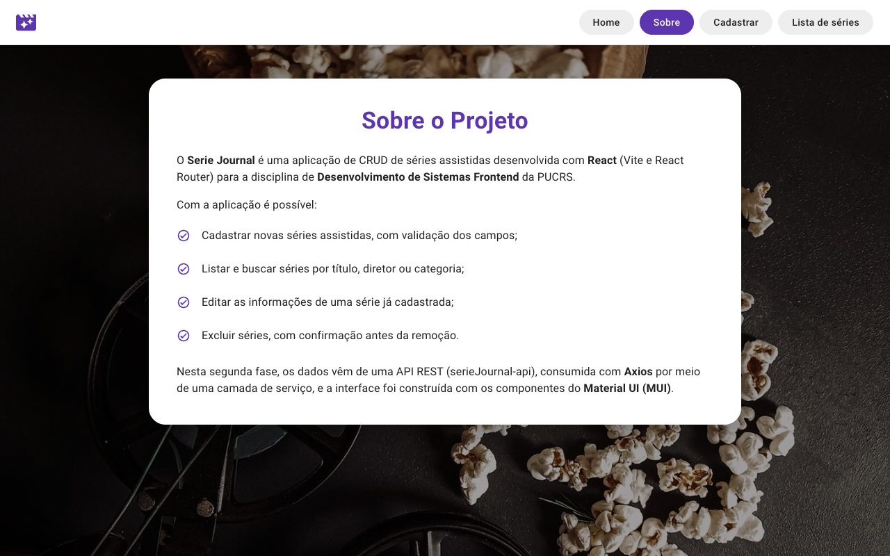
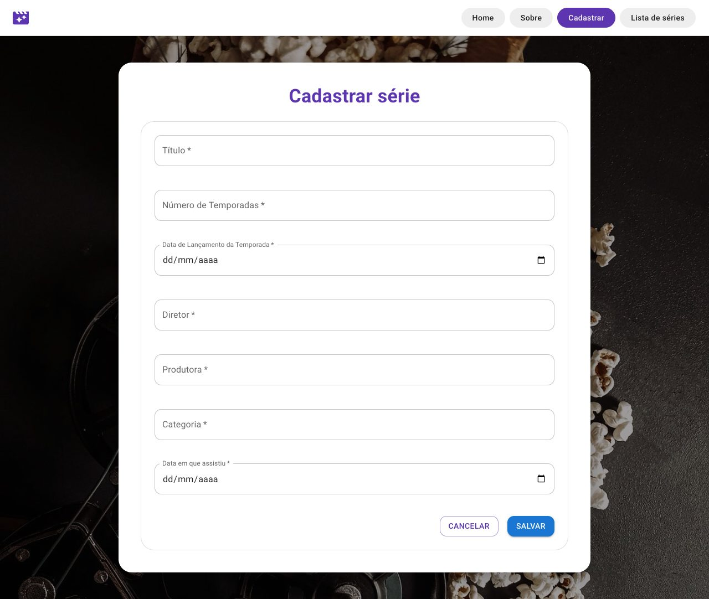
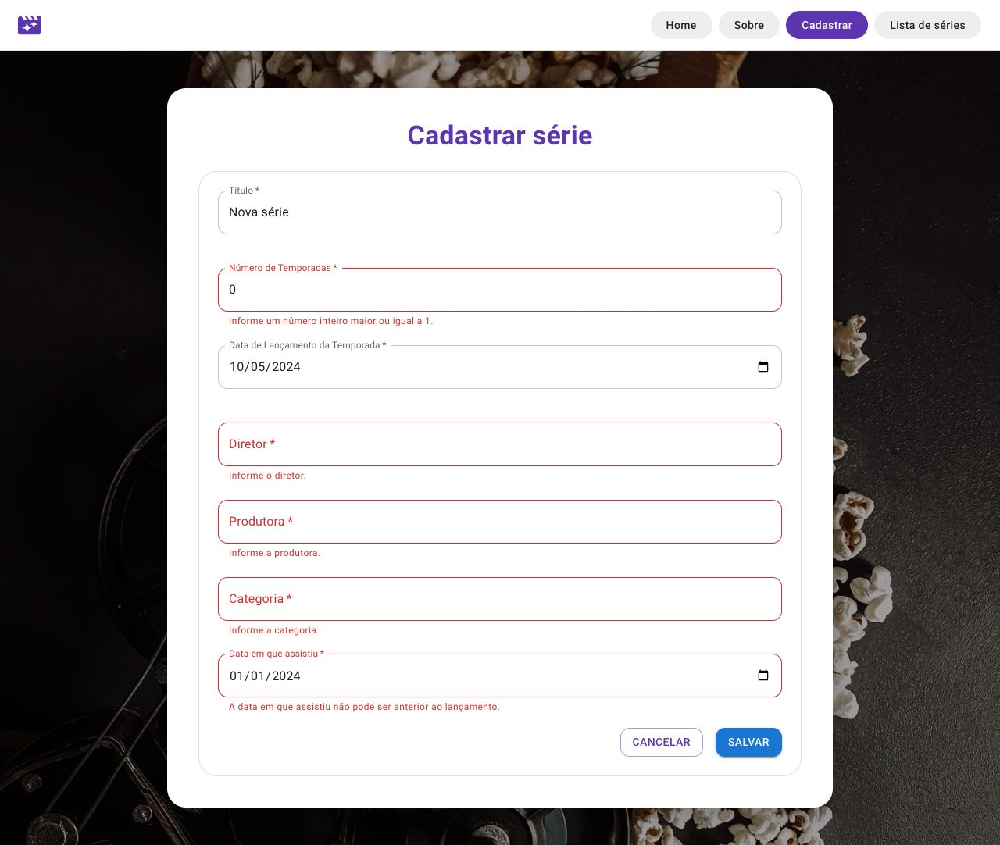
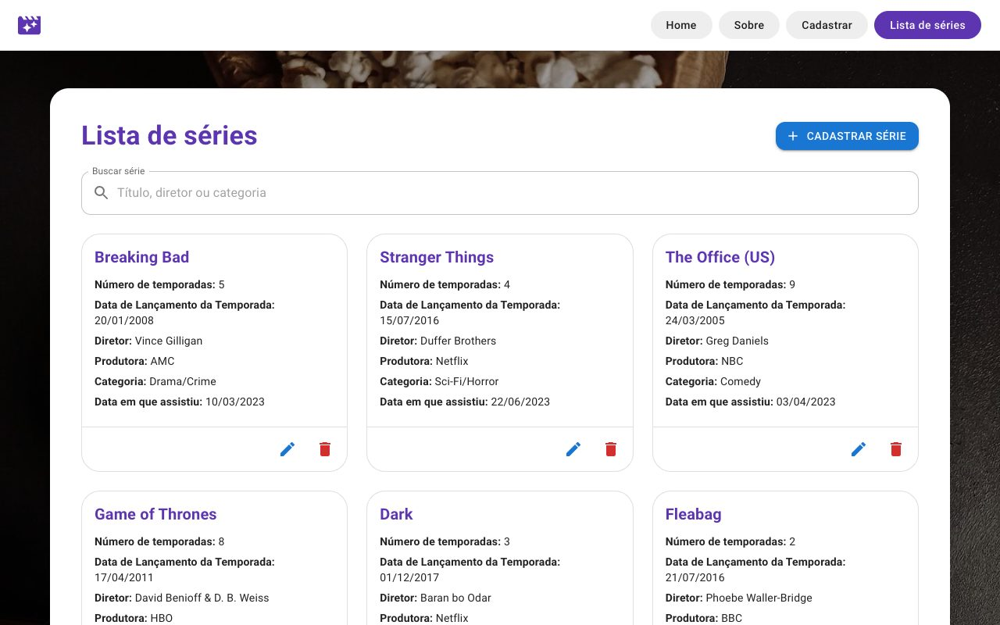
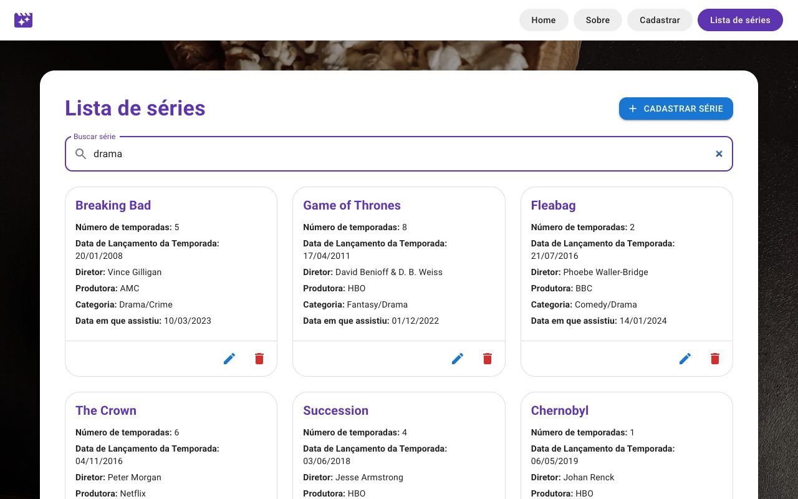
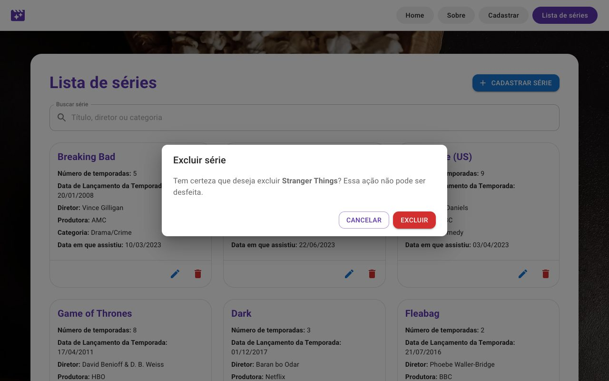
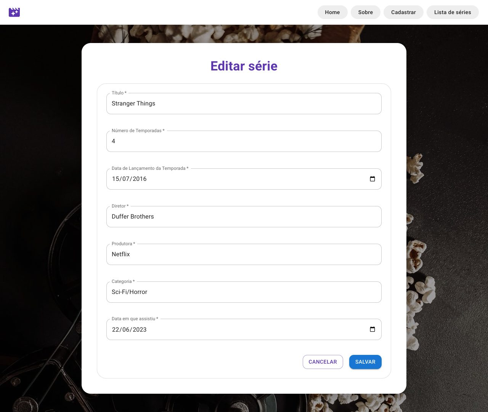
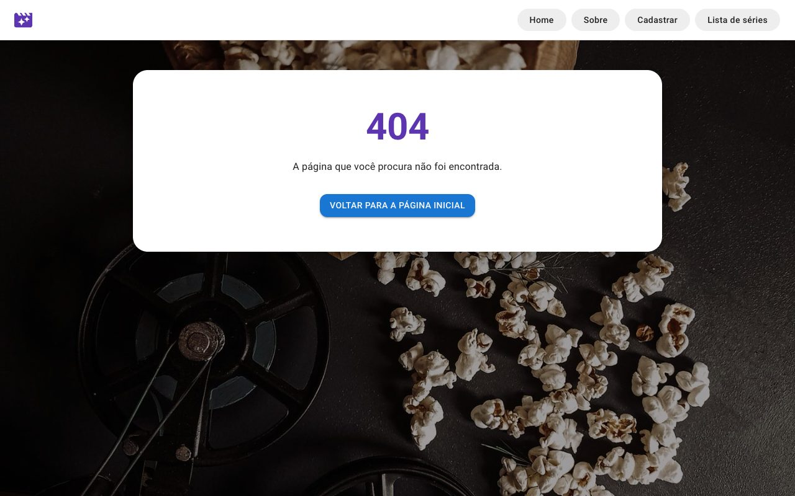
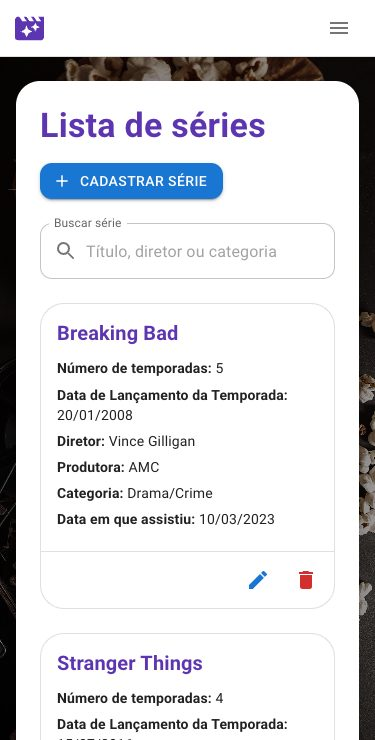
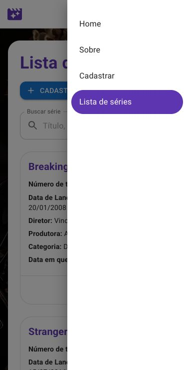

# Serie Journal — Fase 2

CRUD de **séries assistidas** desenvolvido em React para a disciplina
**Desenvolvimento de Sistemas Frontend** (PUCRS). Nesta **Fase 2**, a aplicação
deixa os dados em memória da Fase 1 e passa a consumir a **API REST
serieJournal-api** com **Axios**, ganha interface com **Material UI (MUI)** e uma
suíte de **testes unitários** (Vitest + React Testing Library) e **E2E**
(Playwright).

Autora: **Leticia Pinto Chaves**


---

## Sumário

- [Funcionalidades](#funcionalidades)
- [Tecnologias](#tecnologias)
- [Pré-requisitos](#pré-requisitos)
- [1. Como rodar a API](#1-como-rodar-a-api-seriejournal-api)
- [2. Como rodar o frontend](#2-como-rodar-o-frontend)
- [3. Como rodar os testes](#3-como-rodar-os-testes)
- [Endpoints consumidos](#endpoints-consumidos)
- [Telas](#telas)
- [Componentes e páginas](#componentes-e-páginas)
- [Decisões de desenvolvimento](#decisões-de-desenvolvimento)
- [Estrutura de pastas](#estrutura-de-pastas)
- [Créditos](#créditos)

---

## Funcionalidades

- **Listar** as séries da API em um grid de cards (3 colunas no desktop, 2 no
  tablet e 1 no celular).
- **Buscar** por título, diretor ou categoria, sem diferenciar maiúsculas nem
  acentos.
- **Cadastrar** e **editar** com o mesmo formulário, validado ao sair de cada
  campo e no envio.
- **Excluir** com diálogo de confirmação.
- Feedback em todas as operações: carregamento (Skeleton/CircularProgress),
  erro com "Tentar novamente" e avisos de sucesso/erro (Snackbar).
- Navegação com React Router: Home, Sobre, Cadastrar, Lista, Editar e página 404.
- Layout responsivo e acessível (auditado com axe-core, WCAG 2.1 AA).

## Tecnologias

| Tecnologia | Uso |
|---|---|
| [React 19](https://react.dev/) + [Vite 8](https://vite.dev/) | Base da aplicação (JavaScript/JSX) |
| [React Router 7](https://reactrouter.com/) | Rotas e navegação |
| [Material UI 9](https://mui.com/material-ui/) + Emotion | Componentes, tema e estilo |
| [Axios](https://axios-http.com/) | Requisições HTTP à API |
| [Day.js](https://day.js.org/) | Validação e formatação de datas |
| [Vitest](https://vitest.dev/) + [React Testing Library](https://testing-library.com/) | Testes unitários e de componentes |
| [Playwright](https://playwright.dev/) + [axe-core](https://github.com/dequelabs/axe-core) | Testes E2E e auditoria de acessibilidade |
| [oxlint](https://oxc.rs/docs/guide/usage/linter) | Lint do código |

## Pré-requisitos

- **Node.js 22.12 ou superior** (desenvolvido e testado com Node 26).
- **npm** (acompanha o Node).
- **Git**, para clonar a API.
- Para o teste E2E: **Google Chrome** instalado (veja a observação na seção de testes).

---

## 1. Como rodar a API (serieJournal-api)

> ⚠️ **A API não vem no zip deste projeto.** Ela fica no repositório da
> disciplina e precisa ser clonada e iniciada **antes** do frontend.

```bash
# fora da pasta do projeto
git clone https://github.com/adsPucrsOnline/DesenvolvimentoFrontend.git
cd DesenvolvimentoFrontend/serieJournal-api
npm install
npm start
```

A API sobe em **`http://localhost:5000`**. Para testar:
`curl http://localhost:5000/series`.

> **macOS:** a porta 5000 costuma estar ocupada pelo *Receptor AirPlay*
> (Ajustes do Sistema → Geral → AirDrop e Handoff). Desative-o ou suba a API em
> outra porta, sem alterar o código dela:
>
> ```bash
> PORT=5001 npm start
> ```
>
> e use `VITE_API_URL=http://localhost:5001` no `.env` do frontend.

## 2. Como rodar o frontend

```bash
# na pasta deste projeto
npm install
cp .env.example .env     # VITE_API_URL=http://localhost:5000
npm run dev
```

Abra **`http://localhost:5173`**.

| Comando | O que faz |
|---|---|
| `npm run dev` | Ambiente de desenvolvimento |
| `npm run build` | Build de produção em `dist/` |
| `npm run preview` | Serve a build de produção (`http://localhost:4173`) |
| `npm run lint` | Lint com oxlint |

A URL da API vem da variável **`VITE_API_URL`** (arquivo `.env`). Como o Vite só
lê o `.env` ao iniciar, reinicie o `npm run dev` depois de alterá-lo.

## 3. Como rodar os testes

```bash
npm test             # testes unitários (Vitest) — não precisam da API
npm run test:watch   # modo observação
npm run coverage     # testes + relatório de cobertura (coverage/index.html)
npm run test:e2e     # testes E2E (Playwright) — precisam da API rodando
```

- **Unitários (59 testes, ~93% de cobertura de instruções e 97% de linhas):** o `seriesService` é mockado com
  `vi.mock` e o Axios recebe um adaptador falso, então **os testes não dependem
  da API**. Cobrem NavBar, SerieList, SerieForm, seriesService, a instância do
  Axios (mensagens de erro e novas tentativas), as páginas e os utilitários.
- **E2E (21 testes):**
  - `e2e/crud.spec.js` — fluxo completo cadastrar → ver na lista → editar →
    excluir, usando a API de verdade (a série de teste é removida ao final).
  - `e2e/a11y.spec.js` — auditoria **axe-core (WCAG 2.1 A/AA)** e verificação
    de rolagem horizontal em 375px, 768px e 1280px, em todas as telas, além de
    navegação por teclado.
  - O frontend é iniciado automaticamente. Se a API estiver fora do ar, os
    testes que dependem dela são pulados com uma mensagem.
  - O Playwright usa o **Google Chrome instalado** (`channel: 'chrome'` em
    `playwright.config.js`). Sem o Chrome, rode
    `npx playwright install chromium` e remova a linha `channel`.

Os prints abaixo podem ser gerados de novo com `npm run screenshots` (com a API e
o `npm run dev` rodando).

---

## Endpoints consumidos

Toda chamada HTTP fica centralizada em **`src/services/`**: os componentes nunca
usam o Axios diretamente.

| Operação | Método e rota | Função (`src/services/seriesService.js`) |
|---|---|---|
| Listar | `GET /series` | `getAll()` |
| Buscar por id | `GET /series/:id` | `getById(id)` |
| Cadastrar | `POST /series` | `create(serie)` |
| Editar | `PUT /series` (id **no corpo**) | `update(serie)` |
| Excluir | `DELETE /series/:id` | `remove(id)` |

Modelo de uma série (igual ao da API):

```json
{
  "id": 1,
  "title": "Breaking Bad",
  "seasons": 5,
  "releaseDate": "2008-01-20",
  "director": "Vince Gilligan",
  "production": "AMC",
  "category": "Drama/Crime",
  "watchedAt": "2023-03-10"
}
```

- **`src/services/api.js`** — instância do Axios (`baseURL` do `.env`, timeout de
  10s) e interceptor que converte qualquer erro em um `ApiError` com mensagem em
  português (404, 500, API fora do ar, timeout).
- **`src/services/seriesService.js`** — as 5 operações. Antes de enviar,
  remove espaços das pontas dos textos e converte `seasons` e `id` para número
  (o `PUT` da API compara o id com `===`).

---

## Telas

### Página Inicial


### Sobre


### Cadastrar (vazio)


### Cadastrar (erros de validação)


### Lista de séries


### Busca


### Diálogo de exclusão


### Editar


### Página 404


### Celular (375px)

| Lista | Menu |
|---|---|
|  |  |

---

## Componentes e páginas

### Componentes (`src/components`)

- **`NavBar`** — `AppBar` branco com o ícone de claquete (link para a Home) à
  esquerda e quatro links em formato de pílula à direita (Home, Sobre, Cadastrar,
  Lista de séries). Usa `NavLink` do React Router integrado ao `Button` do MUI: o
  link ativo fica roxo com texto branco. No celular, os links vão para um
  `Drawer` aberto pelo botão de menu.
- **`Layout`** — estrutura comum a todas as rotas: fundo de cinema fixo, NavBar e
  a página dentro de um card branco central (`Paper`). Contém o `<Outlet />` e um
  `Suspense` que mostra um indicador enquanto a página é carregada.
- **`SerieForm`** — formulário único para **cadastrar e editar** (props
  `initialData`, `onSubmit` e `onCancel`). Sete campos `TextField` outlined,
  validação ao sair do campo e no envio (regras em `validation.js`), erros com
  `error` + `helperText`, botão SALVAR com loading e travado contra envio duplo,
  e `Alert` no topo quando a API falha, mantendo o que foi digitado.
- **`SerieList`** — recebe a lista de séries **via props** e mostra o grid de
  cards (`Grid` + `Card`), com rótulos em negrito, datas em `dd/mm/aaaa` e
  botões de editar (lápis azul) e excluir (lixeira vermelha) com `Tooltip` e
  `aria-label`. Trata o estado vazio e abre o `Dialog` de confirmação antes de
  chamar `onDelete`.

### Páginas (`src/pages`)

- **`Home`** (`/`) — título "Página Inicial" em fonte cursiva roxa e mensagem de
  boas-vindas.
- **`About`** (`/sobre`) — explicação do projeto, da disciplina e das tecnologias.
- **`SerieRegister`** (`/cadastrar`) — usa o `SerieForm` e chama `create()`;
  depois mostra "Série cadastrada!" e redireciona para a lista.
- **`SerieListPage`** (`/series`) — busca as séries com `getAll()` (hook
  `useSeries`), mantém o campo de busca e passa a lista filtrada para a
  `SerieList`. Trata carregamento, erro, lista vazia e busca sem resultado, e faz
  a exclusão com `remove()` + Snackbar.
- **`EditSerie`** (`/editar/:id`) — carrega a série com `getById()`, preenche o
  `SerieForm` e salva com `update()`. Mostra "Série não encontrada" para ids
  inexistentes.
- **`NotFound`** (`*`) — página 404.

### Outros módulos

- **`src/hooks/useSeries.js`** — estado da lista (`series`, `loading`, `error`),
  `reload()` e `removeSerie()`.
- **`src/hooks/usePageTitle.js`** — título da aba do navegador por página.
- **`src/contexts/SnackbarProvider.jsx`** — avisos globais; continuam visíveis
  após um redirecionamento.
- **`src/utils/date.js`** — conversões de data (API ⇄ input `YYYY-MM-DD` ⇄
  exibição `dd/mm/aaaa`) e validações.
- **`src/utils/text.js`** — normalização de texto para a busca.
- **`src/theme.js`** — tema do MUI: roxo `#5E35B1` (primária), azul `#1976D2`
  (botões de ação), vermelho de erro, fonte Roboto e a variante cursiva
  (Dancing Script) usada só no título da Home.

---

## Decisões de desenvolvimento

- **Material UI** — oferece componentes prontos e acessíveis (formulários,
  diálogos, Snackbar, grid responsivo) e um tema central, substituindo todo o
  CSS manual da Fase 1. O visual segue a referência: navbar em pílulas, fundo de
  cinema, card central e grid de cards.
- **Camada de serviço** — todas as chamadas HTTP ficam em `src/services`, com uma
  instância única do Axios. Os componentes não conhecem URLs nem o Axios, o que
  facilita trocar a API e mockar nos testes.
- **Nomes da API no frontend** — o modelo usa exatamente os campos da API
  (`title`, `seasons`, `watchedAt`…), sem camada de tradução. Como a API e o
  `<input type="date">` usam o mesmo formato (`YYYY-MM-DD`), só a exibição é
  convertida para `dd/mm/aaaa`.
- **Validação própria** — regras puras em `validation.js` (fáceis de testar):
  campos obrigatórios, temporadas inteiro ≥ 1, datas reais, data em que assistiu
  não futura nem anterior ao lançamento. A API não valida nada, então o frontend
  também normaliza os dados antes de enviar.
- **Categoria em texto livre** — a API tem categorias compostas
  ("Drama/Crime", "Sci-Fi/Horror"), que não caberiam num `select` fixo.
- **CORS e proxy** — a API já habilita CORS para qualquer origem (`cors()`), então
  **não foi preciso proxy no Vite**: o frontend chama a URL do `.env`
  diretamente.
- **Reinício da API após cada escrita** — a API roda com `nodemon`, que observa a
  pasta `data/` e reinicia a cada POST/PUT/DELETE. Por isso:
  - o interceptor repete automaticamente, até 3 vezes, requisições **GET, PUT e
    DELETE** que falham por erro de rede (são idempotentes; o **POST** não é
    repetido, para não cadastrar duas vezes). Esse problema foi encontrado pelo
    teste E2E;
  - depois de excluir, a lista é atualizada localmente, sem buscar tudo de novo.
- **Testes com mock** — os testes unitários mockam o `seriesService` (`vi.mock`)
  ou o adaptador do Axios, então rodam sem a API e de forma determinística. O
  fluxo real com a API fica nos testes E2E.
- **Code splitting** — cada página é carregada sob demanda (`React.lazy`), e
  React e MUI ficam em arquivos separados no build, para que fiquem em cache no
  navegador.
- **Acessibilidade** — labels em todos os campos, `aria-label` nos botões de
  ícone, foco visível, `lang="pt-BR"`, título por página e auditoria automática
  com axe-core.
- **Código em inglês, interface em português.**

---

## Estrutura de pastas

```
serie-journal/
├── docs/screenshots/          # prints e GIF do README
├── e2e/
│   ├── crud.spec.js           # fluxo completo com a API (Playwright)
│   └── a11y.spec.js           # acessibilidade e responsividade
├── public/
├── scripts/screenshots.mjs    # gera os prints (npm run screenshots)
├── src/
│   ├── assets/cinema-background.jpg
│   ├── components/
│   │   ├── Layout/
│   │   ├── NavBar/            # NavBar.jsx + teste
│   │   ├── SerieForm/         # SerieForm.jsx + validation.js + teste
│   │   └── SerieList/         # SerieList.jsx + teste
│   ├── contexts/              # Snackbar global
│   ├── hooks/                 # useSeries, usePageTitle
│   ├── pages/
│   │   ├── About/
│   │   ├── EditSerie/
│   │   ├── Home/
│   │   ├── NotFound/
│   │   ├── SerieListPage/     # + teste
│   │   ├── SerieRegister/
│   │   └── pages.test.jsx     # cadastro e edição
│   ├── services/
│   │   ├── api.js             # instância do Axios + interceptor
│   │   ├── seriesService.js   # getAll, getById, create, update, remove
│   │   └── *.test.js
│   ├── utils/                 # date.js, text.js + testes
│   ├── App.jsx                # rotas
│   ├── App.test.jsx
│   ├── main.jsx               # ThemeProvider, CssBaseline, Snackbar, Router
│   ├── setupTests.js
│   └── theme.js
├── .env.example               # VITE_API_URL
├── index.html
├── package.json
├── playwright.config.js
└── vite.config.js             # inclui a configuração do Vitest
```

---

## Créditos

- **Imagem de fundo:** foto de [hello aesthe](https://www.pexels.com/@helloaesthe/)
  no [Pexels](https://www.pexels.com/photo/close-up-shot-of-popcorns-beside-a-vintage-video-recorder-8652476/),
  usada sob a [licença do Pexels](https://www.pexels.com/license/) (uso gratuito).
- **Fontes:** [Roboto](https://fonts.google.com/specimen/Roboto) e
  [Dancing Script](https://fonts.google.com/specimen/Dancing+Script), do Google
  Fonts.
- **Ícones:** [Material Icons](https://mui.com/material-ui/material-icons/).
- **API:** serieJournal-api, do repositório da disciplina
  [adsPucrsOnline/DesenvolvimentoFrontend](https://github.com/adsPucrsOnline/DesenvolvimentoFrontend).
